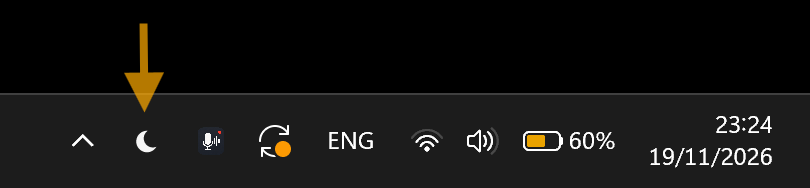
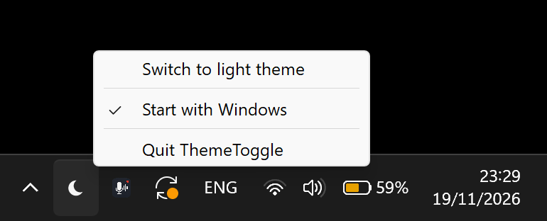
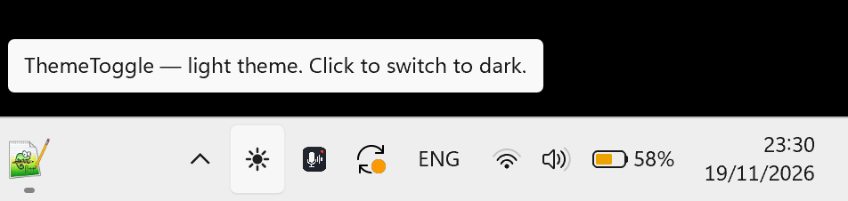

<div align="center">

# ThemeToggle

### One click to switch Windows between light and dark mode

No Settings app, no Personalization → Colors, no restart. A single icon in the
notification area flips the taskbar, the Start menu and every open application
at once.

[](https://github.com/oleamm/themetoggle/releases/latest)

[](https://github.com/oleamm/themetoggle/releases/latest)
[](https://github.com/oleamm/themetoggle/actions/workflows/windows-release.yml)
[](LICENSE)


**Windows 10 / 11 · x64 · single .exe · no installer · no admin rights**

</div>

> [!WARNING]
> **First run: “Windows protected your PC” is expected — click *More info* → *Run anyway*.**
> The executable is not code-signed (a signing certificate costs money), and SmartScreen
> flags every unsigned binary it has never seen. There is nothing else to accept or install.
> The build comes straight from this repository's GitHub Actions run; you can rebuild it
> yourself with `cargo build --release` and compare SHA-256 hashes with the release notes.

---



*Dark theme — the moon sits next to the clock; the arrow points at it.*



*Right click — switch to the other theme, turn autostart on, quit.*



*After the click — the glyph turns into a sun and the tooltip tells you what the next click will do.*

---

## Why

Changing the Windows appearance by hand is a five-step trip through
**Settings → Personalization → Colors → Choose your mode → pick one**, and then
you have to do it again in the evening. Many people switch twice a day.

ThemeToggle reduces that to one left click on an icon that is always next to
the clock.

## Features

- **One click, whole system.** Taskbar, Start menu, Action Center and every open
  app change appearance together — no sign-out, no Explorer restart.
- **The icon tells the truth.** Sun on a light taskbar, moon on a dark one, and
  it is recoloured for the taskbar it sits on so it never blends in. If the
  theme is changed somewhere else, the icon follows within two seconds.
- **Right-click menu:** switch theme · start with Windows · quit.
- **Tiny and quiet.** One process, one thread, no service, no background
  scanning, ~460 KB executable.
- **No admin rights.** Only your own user settings are touched.
- **Single instance.** A second copy refuses to start instead of fighting the
  first one over the same settings.

## Install

1. **[Download `ThemeToggle-windows-x64.zip`](https://github.com/oleamm/themetoggle/releases/latest)**
   and unpack `ThemeToggle.exe` anywhere you like (`C:\Apps` works fine).
2. Run it (first launch shows the SmartScreen prompt described above — *More info* →
   *Run anyway*). The icon appears in the notification area.
3. Optional: right-click the icon → **Start with Windows**.

There is nothing to install and nothing to configure. To uninstall, quit from
the menu, turn autostart off if you enabled it, and delete the file.

> **Keep the icon visible.** Windows puts new tray icons into the overflow
> flyout by default. Drag the icon onto the taskbar, or enable it under
> *Settings → Personalization → Taskbar → Other system tray icons*.

## Usage

| Action | Result |
| --- | --- |
| **Left click** the icon | light ⇄ dark, immediately |
| **Right click** the icon | menu: switch theme, start with Windows, quit |

A double click is treated as one click on purpose — a double click would
otherwise switch twice and appear to do nothing.

## FAQ

**Does it need administrator rights?** No. It writes only to your own user
settings, never to machine-wide ones.

**Will it change my accent colour, wallpaper or transparency?** No. Only the
light/dark mode pair.

**I have a custom setup (light apps, dark taskbar). What happens?** The app
keeps apps and shell in sync, so one click always yields a consistent theme —
that is the point of the button. The icon itself still follows the taskbar
colour, so it stays readable either way.

**My taskbar did not repaint after switching.** Rare, and a known Windows
quirk: the notification is delivered but Explorer occasionally ignores it.
Click again, or restart Explorer (`Task Manager → Windows Explorer → Restart`).
Everything else — Start menu, open apps — updates immediately.

**Does it phone home?** No. There is no network code at all. See
[Privacy](#privacy).

## How it works

Windows stores the per-user appearance in the registry:

| Value | Drives |
| --- | --- |
| `HKCU\Software\Microsoft\Windows\CurrentVersion\Themes\Personalize\AppsUseLightTheme` | application chrome |
| `HKCU\Software\Microsoft\Windows\CurrentVersion\Themes\Personalize\SystemUsesLightTheme` | taskbar, Start, Action Center |

`0` is dark, `1` is light. Writing those values alone does not repaint anything:
running programs re-read them only when they receive `WM_SETTINGCHANGE` with
`lParam = "ImmersiveColorSet"` — the exact broadcast the Settings app sends. So
the app writes both values and broadcasts that message, which is why open apps
switch immediately instead of after a sign-out.

The same values are read back to draw the icon, and a 2-second thread timer
keeps the icon in sync if the theme is changed somewhere else.

Internals: `src/theme.rs` (registry + broadcast), `src/tray.rs` (icon, menu and
the Win32 message loop), `src/icons.rs` (embedded glyphs), `src/autostart.rs`,
`src/instance.rs`, `src/logfile.rs`. Design notes live in
[docs/architecture.md](docs/architecture.md).

## Privacy

- No network access, no telemetry, no analytics, no update checks.
- Reads and writes exactly the two registry values listed above, plus the
  optional per-user autostart entry under
  `HKCU\Software\Microsoft\Windows\CurrentVersion\Run`.
- Writes one local log file, `%LOCALAPPDATA%\ThemeToggle\logs\themetoggle.log`
  (rotated at 1 MiB), so a tray app without a console can still be debugged.
  Set `THEMETOGGLE_LOG=debug` for more detail, `off` to keep it silent.

## Build from source

Requirements: Rust stable with the MSVC toolchain.

```bat
build_release.bat     :: release build staged as dist\ThemeToggle.exe
run_tests.bat         :: cargo test --all-targets
```

Or directly:

```
cargo build --release
cargo test --all-targets
```

`build.rs` embeds the icon and the application manifest into the binary and
bakes a build id (`version+commit.timestamp`) into it, which is written to the
log on every start — so a shipped `.exe` can be traced back to a commit.

The tray and application icons are generated, not borrowed:
`tools/make_icons.py` rasterises the sun, the moon and the multi-size `.ico`
analytically, without any imaging library.

### CI

| Workflow | Trigger | What it does |
| --- | --- | --- |
| `windows-release.yml` | push to `main`, tag `v*`, manual | tests, release build, uploads the build artifact, publishes a GitHub release for tags |
| `ci-check.yml` | pull requests, `fix/**`, manual | tests, release build |

## License

MIT — see [LICENSE](LICENSE).
